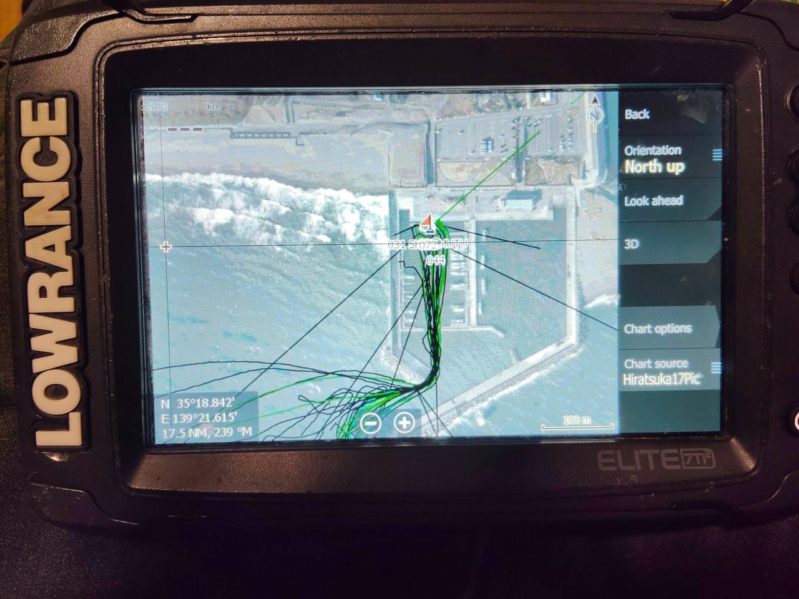
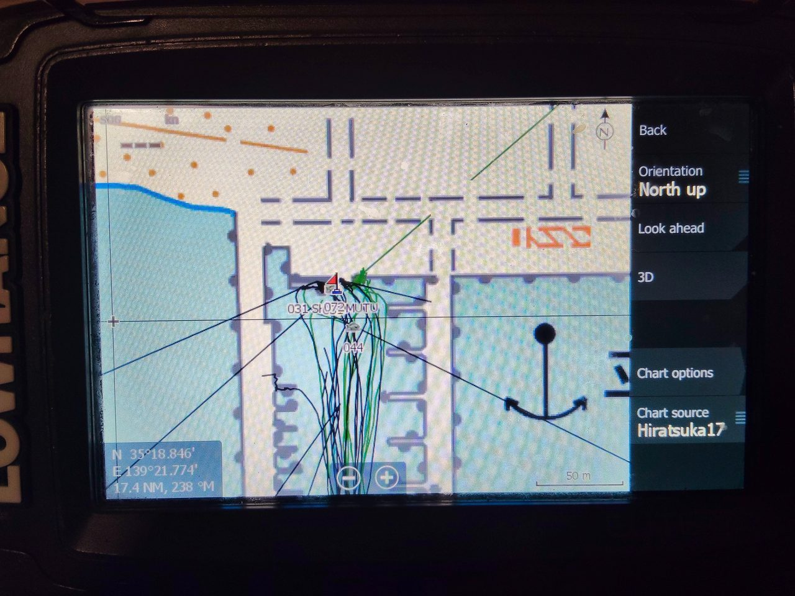

# Lowrance魚群探知機用 AT5日本地図作成ツール

地図タイルから地図画像を取得し、Insight Map Creator（IMC）でLowrance機器向けのAT5ラスター地図を作成するWindows用ツールです。地図範囲はブラウザー画面で選べます。Pythonやコマンドを普段使わない方も、手順に沿ってセットアップできます。

> **対応機種について：** 作成したAT5ラスター地図はLowrance Elite Ti2で表示を確認しています。その他の機種では動作確認をしていません。AT5ラスター地図への対応や操作メニューは機種・ソフトウェアバージョンにより異なる可能性があるため、利用前にお使いの機器で確認してください。
>
> 他機種で表示を確認できた方は、機種名・ソフトウェアバージョン・表示結果を[GitHub Discussions](https://github.com/tocoma0201/at5-map-builder/discussions)でお知らせください。

> **対応環境：Windows 10/11のみ。** IMCのWindows版を起動してAT5を作るため、macOS・Linuxでは動作しません。

## 画面イメージ

地図範囲の指定、概算容量、出力先の設定を行う画面です。

Ti2のChart source一覧から「KanagawaNanbu」を選んで表示した例です。

## できること

- 地図をドラッグして移動し、必要な範囲を矩形で選択
- 範囲を南・西・北・東の緯度経度で直接入力
- 背景地図は「JP: 国土地理院 / 標準地図」「JP: 国土地理院 / 航空写真」「US: USGS / 航空写真」から選択
- 国土地理院の湖沼図（等深線）を背景地図に重ねて出力
- 出力ズームレベルをZL15～17から選択
- 範囲面積・タイル数・AT5容量の概算表示
- 地図セット名を付け、Ti2のChart sourceで選べるように設定
- 生成したAT5をPC内の任意フォルダーやSDカードへコピー
- 地図の種類・ズーム・範囲ごとに作業データを分け、異なる画像やキャッシュの混在を防止
- 前回の範囲や設定を次回起動時に復元
- 画面表示を日本語・英語から選択（言語追加は今後の更新で対応）

初回起動時は、Windowsの国または地域の設定が日本なら国土地理院の標準地図、日本以外ならUSGS航空写真を初期選択します。日本以外でUSGSを選んだ場合は、初期表示範囲も米国内になります。画面の初期言語はWindowsの表示言語に合わせ、日本語・英語以外は英語で表示します。地図と表示言語は画面から変更でき、次回起動時も選択が保持されます。画面上部の言語メニューは常に「Language」と表示されます。ビルド中のターミナル出力は日本語です。

## バージョン0.2.0で追加した地図機能

### 背景地図と湖沼図

背景には国土地理院の標準地図または全国最新写真（シームレス）を選べます。航空写真タイルはZL14以上で提供されるため、プレビューで広域を表示するときは標準地図を背景にし、航空写真タイルが利用できるズームで写真を重ねます。これはプレビューの表示方法で、作成時に選んだ背景地図は変わりません。湖沼図（等深線）を有効にすると、選んだ背景地図に等深線を重ねて一枚の画像として出力します。湖沼図の等深線は背景地図に焼き込まれるため、魚探上で湖沼図の等深線だけを個別に表示・非表示にはできません。等深線あり・なしを別々に使いたい場合は、設定を変えて地図をそれぞれ作成し、異なる地図名を付けてください。

湖沼図は国土地理院が調査・公開している湖沼の範囲だけで利用できます。海の等深線や未整備の湖沼を追加する機能ではありません。航空写真は全国最新写真（シームレス）の提供状況に従います。複数の時期・提供元の写真を組み合わせたタイルのため、場所によって撮影時期や画質が異なり、写真がない範囲や水面などで空白・継ぎ目が見える場合があります。 ビルド時に航空写真タイルが404で取得できない場合は、そのタイルを標準地図で補って処理を続けます。ZL15～17を切り替えてもブラウザーのプレビュー倍率は変わりません。ZLはAT5作成時の画像解像度を指定します。

### ズームレベル（ZL15・ZL16・ZL17）

このツールのZLは、地図画像の作成時に取得する地理院タイルのズームレベルです。1回の作成で1つ選びます。魚探で切り替える設定ではありません。ZLを上げるほど細かい地図画像を使えますが、同じ範囲を作るためのタイル数が増え、処理時間やデータ容量も大きくなります。

| ズームレベル | 特徴 |
| --- | --- |
| ZL15 | 3段階の中では最も軽く、比較的広い範囲を作るのに向いています。 |
| ZL16 | ZL15より一段細かく、詳細さとデータ量の中間です。 |
| ZL17 | 最も細かく表示できますが、同じ範囲ではタイル数が最も多くなります。 |

ズームレベルが1段上がるごとに、同じ長さを表すピクセル数は約2倍（1ピクセルが表す地上の範囲は約半分）になり、同じ地理範囲に必要なタイル数は約4倍になります。実際のファイル容量は画像の内容や圧縮率によって変わります。また、元の地図や航空写真に細部がない場所では、ZLを上げても情報は増えません。 ZL15からZL17へ上げると、同じ範囲でタイル数は目安として約16倍になります。

### Ti2での航空写真・ZL17地図の表示例

航空写真を背景に選び、ZL17で作成した地図をElite Ti2で表示した例です。地図名「Hiratsuka17Pic」で航空写真、「Hiratsuka17」でZL17の地図を確認しています。

## USGS航空写真の試験対応

背景地図に「US: USGS / 航空写真」を選ぶと、USGS The National MapのUSGS Imagery Onlyタイルを利用します。高解像度の航空写真は主に米国本土を対象とし、地域により画像の解像度や撮影時期が異なります。アラスカなどでは解像度が低く、米国外では詳細な航空写真が利用できない場合があります。

USGS航空写真はZL16まで利用できます。ZL17のタイルは取得できない地域があるため、USGSを選んでいる間はZL17を選択できません。タイルが提供されない範囲ではビルドが失敗することがあります。まず小さな範囲で取得・表示を確認してください。現在のUSGS対応は航空写真のみです。米国向け公開は、USGS地形図もビルド・実機表示できることと、出典・利用条件の確認が済んでから行います。

出典：USDA, USGS The National Map: Orthoimagery。詳細は[USGS Imagery Only](https://basemap.nationalmap.gov/arcgis/rest/services/USGSImageryOnly/MapServer)を参照してください。

## 必要なもの

1. Windows 10/11
2. Python 3.9以降 for Windows（py、python、python3 のいずれかで起動できること）
3. Insight Map Creator（IMC）Windows x64版
4. 地図タイル取得時のインターネット接続
5. microSDカード（魚探へデータを移す場合）

## セットアップ

### 1. ファイルを配置

リポジトリの **Code → Download ZIP** からZIPをダウンロードし、PC上の好きな場所へ展開します。インストール先は任意です。展開先のフォルダーを移動しても構いません。

### 2. Pythonを用意

Pythonがまだない場合は、Install_Python.bat をダブルクリックします。WinGetが使えるPCではPython 3.14をインストールし、WinGetがない場合はPython公式ダウンロードページを開きます。画面の案内に従ってください。

すでにPythonを使っている場合は、再インストール不要です。python.orgのインストーラー、Microsoft Store、WinGetなど、どの方法で入れたPythonでも構いません。起動時に py -3、python、python3 の順で利用可能なPythonを自動検出します。**py コマンドは必須ではありません。**

PowerShellで、使えるコマンドのいずれかを実行してPython 3.9以降が表示されることを確認します。

    python --version
    python3 --version
    py -3 --version

Pythonをインストールした直後は、開いているPowerShellやエクスプローラーを閉じて開き直してください。

### 3. 依存ライブラリーをセットアップ

展開したフォルダーでPowerShellを開き、次を実行します。

    powershell -ExecutionPolicy Bypass -File .\setup.ps1

このスクリプトはWindows上で利用可能なPythonを自動検出し、地図画像処理に必要なPillowを設定します。既存の環境に応じて py、python、python3 を使い分けます。

### 4. Insight Map Creatorを用意

IMCはこのリポジトリに同梱していません。配布元から取得し、READMEの案内に沿って展開してください。IMC本体ZIPを展開し、Sample ZIPまたは展開済みのIMC_Sampleフォルダーを残せばツールがRaster Mode設定を読み取ります。Sample ZIPをすでに展開済みなら、検出できる場所にIMC_Sampleフォルダーがある限りZIPを削除しても構いません。詳しくは [IMC_INSTALL.md](./IMC_INSTALL.md) を参照してください。

## 困ったとき

インストールで困った場合は、このREADMEのURL（https://github.com/tocoma0201/at5-map-builder）をAIサービスに伝えて相談する方法もあります。エラー画面やログを共有する場合は、ユーザー名や個人のフォルダー名などが含まれていないか確認してください。

## 起動と地図作成

1. Start_AT5_Map_Builder.bat をダブルクリックします。ブラウザーで範囲設定画面が開きます。
2. 地図をドラッグして移動します。「範囲選択」をONにしてドラッグすると、作成範囲を指定できます。
3. 地図をドラッグして範囲を選ぶか、「範囲（南, 西, 北, 東）」欄へ4つの数値を入力してEnterを押します。どちらで指定しても、最後に設定した範囲が地図とPowerShellコマンドに反映されます。
4. 「Ti2で選ぶ地図名／AT5先頭文字」に、他の地図セットと重ならない英数字名を入力します（例：KanagawaNanbu）。この名前はAT5ファイル名とAtlas Descriptionに設定されます。
5. 初回起動時に「IMCの場所を設定」が開きます。InsightMapCreator.exeをエクスプローラーで右クリックして「パスのコピー」を選び、入力欄へ貼り付けて保存します。Raster Mode設定ファイルを選ぶ必要はありません。Sampleの設定が見つからない場合は、[IMC導入手順](./IMC_INSTALL.md)に従い、Sample ZIPまたは展開済みのIMC_SampleフォルダーがIMC本体の近くにあるか確認してください。
6. 出力先フォルダーを入力します。画面下部に生成されたPowerShellコマンドは、必要に応じて編集できます。「PowerShellで実行」を押すと別ウィンドウで地図を作成します。進行状況と詳細はPowerShell側で確認できます。

IMCの場所、範囲、出力先などはこのPCのアプリ設定として保存され、次回から再入力は不要です。パスを間違えた場合やIMCの展開先を変えた場合は、画面の「IMC設定」から正しいInsightMapCreator.exeの場所を再登録してください。Raster Mode設定は同じフォルダーにあるSample ZIPから取得し、PC全体の自動検索は行いません。

出力ズームはZL15～17です。背景地図や湖沼図の表示・提供範囲は国土地理院のタイルにより異なります。湖沼図（等深線）は調査済みの湖沼だけを対象とし、対象範囲外のタイルは透明として背景地図を表示します。地図セットを複数作る場合は、Ti2で区別できるよう、それぞれ異なる地図名を指定してください。

## Ti2へコピーして表示

指定した出力先には、ビルドで生成したAT5と、その地図の出典・利用上の注意を記録した `<地図名>_SOURCE_NOTICES.txt` がコピーされます。地図名を指定しない場合は、背景地図・ズーム・範囲を含むファイル名になります。SDカードへコピーする場合は、魚探で使うカードの ShadedRelief フォルダーを出力先に指定します。既存の同名AT5は置き換わります。別地域の地図を同じカードへ入れる場合は、地図名をそれぞれ異なる値にしてください。出典記録もAT5と一緒に保管してください。

Ti2ではChart source一覧から、作成時に指定した地図名を選びます。表示設定の手順は [TI2_DISPLAY_GUIDE.md](./TI2_DISPLAY_GUIDE.md) を参照してください。

## 法的な注意と安全

- MIT Licenseは本ツールのプログラムに適用されます。国土地理院の地図タイル、生成した地図データ、IMCには適用されません。それぞれの利用条件に従ってください。
- USGS The National Mapのデータはパブリックドメインとされていますが、USGSは派生した製品・データにも出典表示を求めています。USGS Imagery Onlyは複数の画像ソースを含み、地域ごとに解像度や利用条件が異なる場合があります。USGSの出典表示が、全地域・全タイルの利用条件確認や必要な手続きの代わりになるものではありません。
- 地理院タイルを使った地図を公開・配布する場合は、利用形態に応じて測量法上の承認申請が必要になることがあります。公開前に国土地理院の案内で確認してください。申請が不要な場合も、地図の出典を明記してください。
- ビルドで使った地図ソース・出典・範囲・出力ズームを記録したテキストファイルをAT5と一緒に保存します。この記録は利用許諾や法令上の手続きが完了した証明ではありません。利用者は、生成地図の配布・公開・使用前に、対象地域の最新の公式条件と必要な手続きを確認してください。
- 生成地図は正式な航海用海図ではありません。位置・海岸線・水深・障害物の正確性、完全性、最新性、機器との適合性を保証しません。利用者自身が内容と機器上の表示を確認し、正式な海図・機器の説明書・現地情報を参照して利用方法や航行を判断してください。
- 本ツールおよび生成地図は現状有姿で提供されます。適用法令で認められる範囲で、提供者は生成地図の利用または利用不能から生じる損害について責任を負いません。この記載は、適用法令により制限できない責任を除外するものではありません。免責文だけで全ての法域における法的責任を排除できるとは限りません。
- 詳細：[地図データの権利・安全に関する案内](./DATA_AND_SAFETY.md)。公式情報：[USGS Imagery Only](https://basemap.nationalmap.gov/arcgis/rest/services/USGSImageryOnly/MapServer)、[The National Mapの利用条件](https://www.usgs.gov/faqs/what-are-terms-uselicensing-map-services-and-data-national-map)、[地理院タイル一覧（対象範囲・ズームレベル・出典）](https://maps.gsi.go.jp/development/ichiran.html)、[国土地理院・測量成果の利用手続](https://www.gsi.go.jp/LAW/2930-index.html)、[地理院タイル利用上の注意](https://maps.gsi.go.jp/help/use.html)

## ライセンス

本ソフトウェアは [MIT License](./LICENSE) で提供します。地図データ・IMCの権利や利用条件は各提供元に帰属します。
