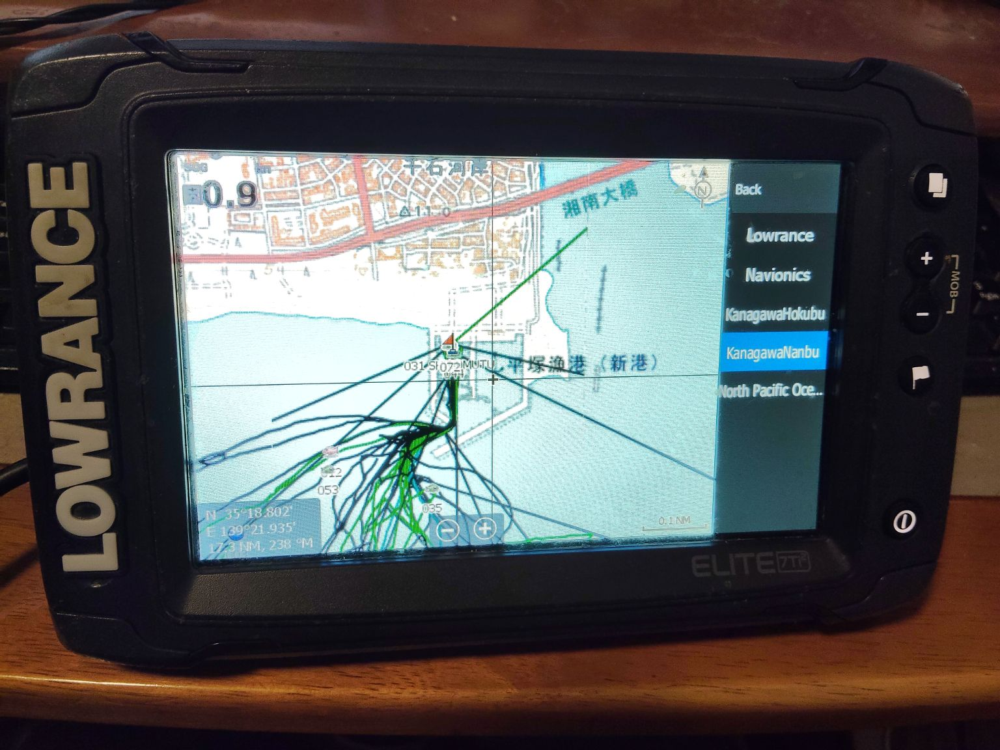

# Lowrance魚群探知機用 AT5日本地図作成ツール

地理院タイルから地図画像を取得し、Insight Map Creator（IMC）でLowrance機器向けのAT5ラスター地図を作成するWindows用ツールです。地図範囲はブラウザー画面で選べます。Pythonやコマンドを普段使わない方も、手順に沿ってセットアップできます。

> **対応機種について：** 作成したAT5ラスター地図はLowrance Elite Ti2で表示を確認しています。その他の機種では動作確認をしていません。AT5ラスター地図への対応や操作メニューは機種・ソフトウェアバージョンにより異なる可能性があるため、利用前にお使いの機器で確認してください。
>
> 他機種で表示を確認できた方は、機種名・ソフトウェアバージョン・表示結果を[GitHub Discussions](https://github.com/tocoma0201/at5-map-builder/discussions)でお知らせください。

> **対応環境：Windows 10/11のみ。** IMCのWindows版を起動してAT5を作るため、macOS・Linuxでは動作しません。

## 画面イメージ

地図範囲の指定、概算容量、出力先の設定を行う画面です。

Ti2のChart source一覧から「KanagawaNanbu」を選んで表示した例です。

## できること

- 地図をドラッグして移動し、必要な範囲を矩形で選択
- 範囲を南・西・北・東の緯度経度で直接入力
- 背景を国土地理院の標準地図または全国最新写真（シームレス）から選択
- 国土地理院の湖沼図（等深線）を背景地図に重ねて出力
- 出力ズームレベルをZL15～17から選択
- 範囲面積・タイル数・AT5容量の概算表示
- 地図セット名を付け、Ti2のChart sourceで選べるように設定
- 生成したAT5をPC内の任意フォルダーやSDカードへコピー
- 地図の種類・ズーム・範囲ごとに作業データを分け、異なる画像やキャッシュの混在を防止
- 前回の範囲や設定を次回起動時に復元

湖沼図は国土地理院が調査・公開している湖沼の範囲だけで利用できます。海の等深線や未整備の湖沼を追加する機能ではありません。航空写真は全国最新写真（シームレス）の提供状況に従います。

地図タイル数や容量が推奨目安を超えた場合は警告を表示します。警告後も作成できます。概算容量は目安で、地図内容やズーム、IMCの分割結果により変わります。

## 必要なもの

1. Windows 10/11
2. Python 3.9以降 for Windows（`py`、`python`、`python3` のいずれかで起動できること）
3. Insight Map Creator（IMC）Windows x64版
4. 地図タイル取得時のインターネット接続
5. microSDカード（魚探へデータを移す場合）

## セットアップ

### 1. ファイルを配置

リポジトリの **Code → Download ZIP** からZIPをダウンロードし、PC上の好きな場所へ展開します。インストール先は任意です。展開先のフォルダーを移動しても構いません。

### 2. Pythonを用意

Pythonがまだない場合は、`Install_Python.bat` をダブルクリックします。WinGetが使えるPCではPython 3.14をインストールし、WinGetがない場合はPython公式ダウンロードページを開きます。画面の案内に従ってください。

すでにPythonを使っている場合は、再インストール不要です。python.orgのインストーラー、Microsoft Store、WinGetなど、どの方法で入れたPythonでも構いません。起動時に `py -3`、`python`、`python3` の順で利用可能なPythonを自動検出します。**`py` コマンドは必須ではありません。**

PowerShellで、使えるコマンドのいずれかを実行してPython 3.9以降が表示されることを確認します。

    python --version
    python3 --version
    py -3 --version

Pythonをインストールした直後は、開いているPowerShellやエクスプローラーを閉じて開き直してください。

### 3. 依存ライブラリーをセットアップ

展開したフォルダーでPowerShellを開き、次を実行します。

    powershell -ExecutionPolicy Bypass -File .\setup.ps1

このスクリプトはWindows上で利用可能なPythonを自動検出し、地図画像処理に必要なPillowを設定します。既存の環境に応じて `py`、`python`、`python3` を使い分けます。

### 4. Insight Map Creatorを用意

IMCはこのリポジトリに同梱していません。配布元から取得し、READMEの案内に沿って展開してください。IMC本体ZIPを展開し、Sample ZIPまたは展開済みのIMC_Sampleフォルダーを残せばツールがRaster Mode設定を読み取ります。Sample ZIPをすでに展開済みなら、検出できる場所にIMC_Sampleフォルダーがある限りZIPを削除しても構いません。詳しくは [IMC_INSTALL.md](./IMC_INSTALL.md) を参照してください。

## 困ったとき

インストールで困った場合は、このREADMEのURL（https://github.com/tocoma0201/at5-map-builder）をAIサービスに伝えて相談する方法もあります。エラー画面やログを共有する場合は、ユーザー名や個人のフォルダー名などが含まれていないか確認してください。

## 起動と地図作成

1. Start_AT5_Map_Builder.bat をダブルクリックします。ブラウザーで範囲設定画面が開きます。
2. 地図をドラッグして移動します。「範囲選択」をONにしてドラッグすると、作成範囲を指定できます。
3. 地図をドラッグして範囲を選ぶか、「範囲（南, 西, 北, 東）」欄へ4つの数値を入力してEnterを押します。どちらで指定しても、最後に設定した範囲が地図とPowerShellコマンドに反映されます。
4. 「Ti2で選ぶ地図名／AT5先頭文字」に、他の地図セットと重ならない英数字名を入力します（例：KanagawaNanbu）。この名前はAT5ファイル名とAtlas Descriptionに設定されます。
5. 初回起動時に「IMCの場所を設定」が開きます。InsightMapCreator.exeをエクスプローラーで右クリックして「パスのコピー」を選び、入力欄へ貼り付けて保存します。Raster Mode設定ファイルを選ぶ必要はありません。Sampleの設定が見つからない場合は、[IMC導入手順](./IMC_INSTALL.md)に従い、Sample ZIPまたは展開済みのIMC_SampleフォルダーがIMC本体の近くにあるか確認してください。
6. 出力先フォルダーを入力します。画面下部に生成されたPowerShellコマンドは、必要に応じて編集できます。「PowerShellで実行」を押すと別ウィンドウで地図を作成します。進行状況と詳細はPowerShell側で確認できます。

IMCの場所、範囲、出力先などはこのPCのアプリ設定として保存され、次回から再入力は不要です。パスを間違えた場合やIMCの展開先を変えた場合は、画面の「IMC設定」から正しいInsightMapCreator.exeの場所を再登録してください。Raster Mode設定は同じフォルダーにあるSample ZIPから取得し、PC全体の自動検索は行いません。

出力ズームはZL15～17です。背景地図や湖沼図の表示・提供範囲は国土地理院のタイルにより異なります。湖沼図（等深線）は調査済みの湖沼だけを対象とし、対象範囲外のタイルは透明として背景地図を表示します。地図セットを複数作る場合は、Ti2で区別できるよう、それぞれ異なる地図名を指定してください。

## Ti2へコピーして表示

指定した出力先には、ビルドで生成したAT5だけがコピーされます。SDカードへコピーする場合は、魚探で使うカードの ShadedRelief フォルダーを出力先に指定します。既存の同名AT5は置き換わります。別地域の地図を同じカードへ入れる場合は、地図名をそれぞれ異なる値にしてください。

Ti2ではChart source一覧から、作成時に指定した地図名を選びます。表示設定の手順は [TI2_DISPLAY_GUIDE.md](./TI2_DISPLAY_GUIDE.md) を参照してください。

## 法的な注意と安全

- MIT Licenseは本ツールのプログラムに適用されます。国土地理院の地図タイル、生成した地図データ、IMCには適用されません。それぞれの利用条件に従ってください。
- 地理院タイルを使った地図を公開・配布する場合は、利用形態に応じて測量法上の承認申請が必要になることがあります。公開前に国土地理院の案内で確認してください。申請が不要な場合も、地図の出典を明記してください。
- 参照先：[地理院タイル一覧（対象範囲・ズームレベル・出典）](https://maps.gsi.go.jp/development/ichiran.html)、[国土地理院・測量成果の利用手続](https://www.gsi.go.jp/LAW/2930-index.html)、[地理院タイル利用上の注意](https://maps.gsi.go.jp/help/use.html)、[地図の利用手続ナビ](https://service.gsi.go.jp/onestop/navi/)
- 生成した地図は正式な航海用海図ではなく、航行の安全や水深・障害物の正確性を保証しません。航行には正式な海図、機器の説明書、現地情報を利用してください。

## ライセンス

本ソフトウェアは [MIT License](./LICENSE) で提供します。地図データ・IMCの権利や利用条件は各提供元に帰属します。
